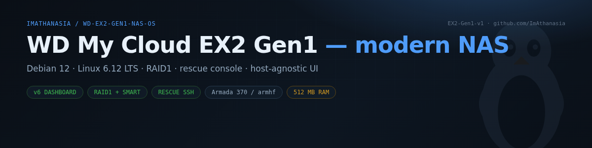
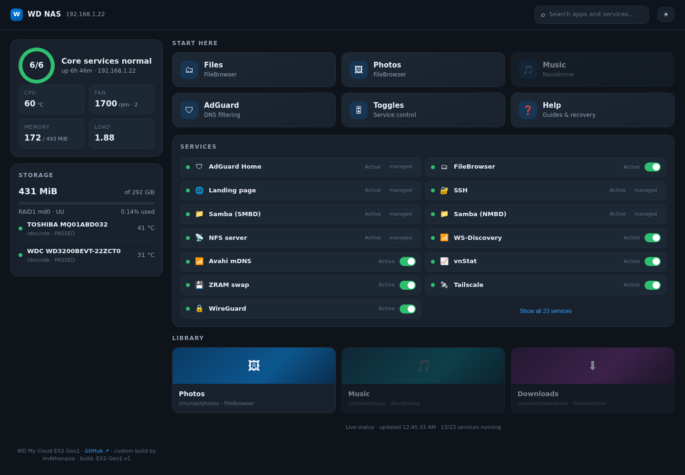
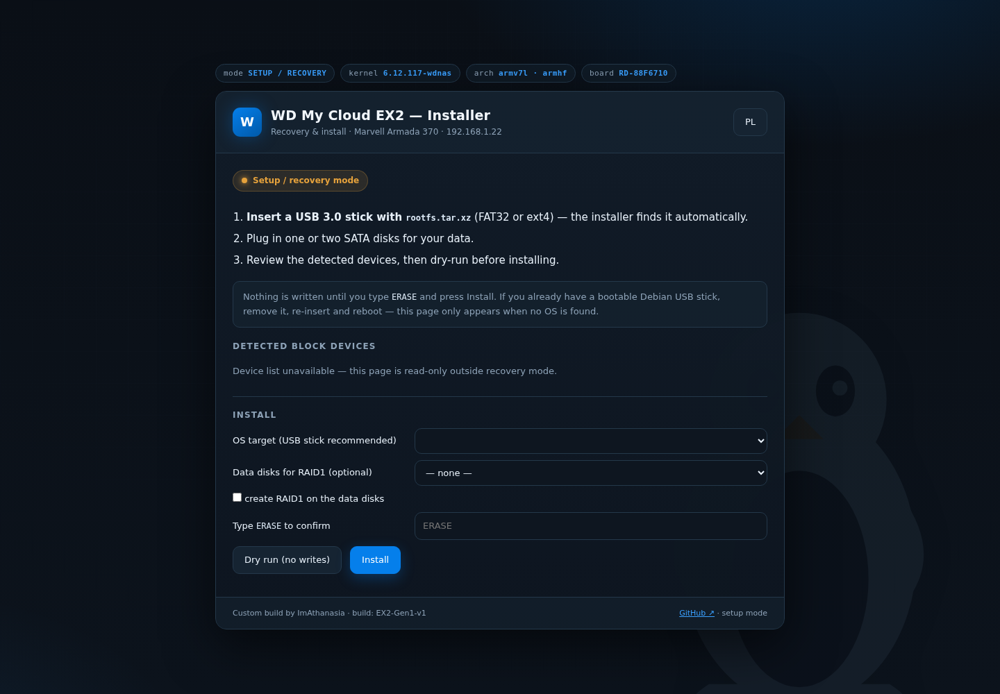
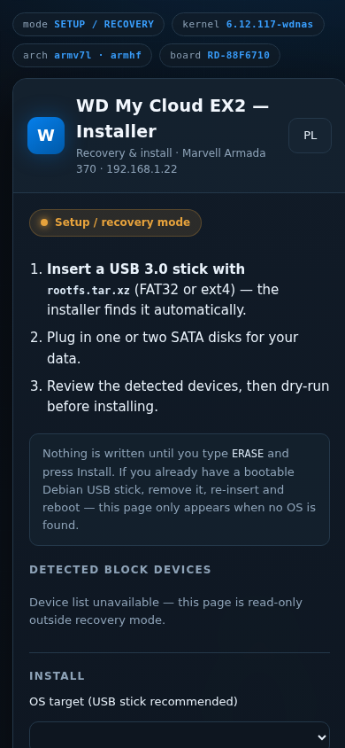
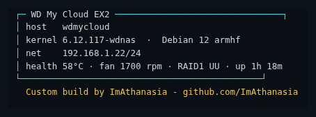
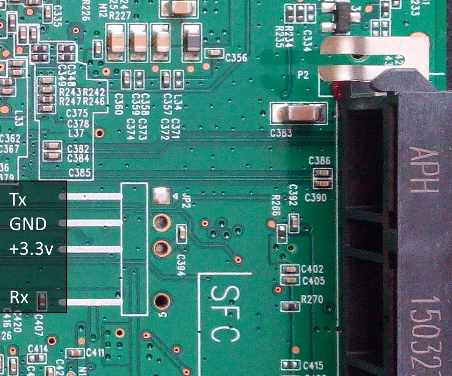

# WD My Cloud EX2 Gen1

A small ARM home server built from the WD My Cloud EX2 Gen1. It runs Debian 12
and Linux 6.12 LTS on the original Marvell Armada 370 board with 512 MB RAM.

Build: EX2-Gen1-v1.

## What it does

The two SATA bays run as ext4 RAID1. Samba and NFS share the data. FileBrowser,
AdGuard Home, WireGuard and Tailscale run on the box. Other apps, including
Syncthing, Navidrome, Transmission, minidlna, Glances and CUPS, start only when
needed. That keeps RAM free.

The web dashboard shows live status and service switches. It works on a phone.
The rescue image has SSH, read-only diagnostics and a web installer with a dry
run.

## Screenshots

| | |
|---|---|
|  |  |

Console login:

The dashboard, rescue and console screens are captures of the running system.
No mockups are used here.

## Release image

The rootfs image is distributed as a compressed tarball with a `.sha256` file.
Verify the digest before installing it.

## Start here

**Start here:** `docs/INSTALL-START-HERE.md`. It explains the
3.3V USB-UART adapter, the JP2 pinout, TFTP in Windows, the U-Boot commands and
the web installer.

Project facts and limits are in `PROJECT-NOTES.md`.

If your box already has this project's kernel and boot manager, insert the USB
root stick and power on. The first install still needs serial access once,
because the WD updater will not accept an unsigned kernel.

## Repo layout

| Path | What is in it |
|---|---|
| `rescue/` | Rescue image sources, installer CGI, MOTD generator |
| `dts/upstream/` | Board DTS patch and submission notes |
| `docs/` | Build, install, recovery and hardware notes |
| `scripts/` | Backup, config export, rootfs build and media count helpers |

## Limits

The RTC battery is dead, so the clock is set from an HTTP `Date:` header.
NAND mtd6 still holds stock config data, so config backups go to
`/srv/nas/backups/config/` instead.

## Hardware donations

I can accept EX2 boards, SATA disks, USB sticks and lab gear such as logic
analyzers or programmers in Europe. Shipping is arranged case by case. Donated
hardware goes into testing and documentation.

## Credit

Custom build by ImAthanasia. github.com/ImAthanasia.
Installed packages keep their own licenses.
