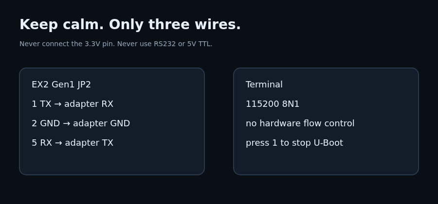
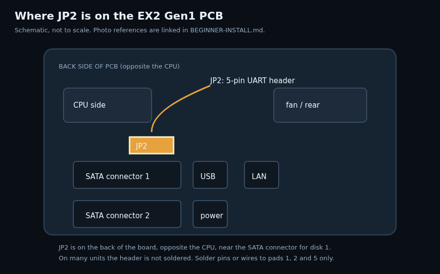
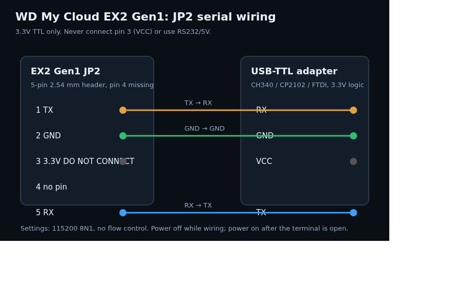

# Install Debian on WD My Cloud EX2 Gen1

This guide gets a stock EX2 Gen1 (Armada 370, 512 MB RAM) from WD's firmware
to this project's Debian build. It follows the same order as gisab's WDMC-Ex2
guide: get serial, boot the kernel, install the root filesystem.

This guide is for Gen1 only. EX2 Ultra is a different board with a different
pinout.




## Defaults for a new install

Read this before the steps. These are the defaults in the shipped build.

Network:

- The setup image asks the router for DHCP first.
- If DHCP fails, it falls back to `192.168.1.22/24`. The rescue backchannel is
  `http://192.168.1.22:8098/status.json`.
- The installed Debian build in this repo uses static `192.168.1.22/24`,
  gateway `192.168.1.1`, DNS `1.1.1.1`. Change this in
  `/etc/systemd/network/20-eth0.network` for your network.
- Find a DHCP address in your router's client list, or run `ip -4 addr show eth0`
  on the serial console.

Logins in the demo build. Change all of them before exposing the box:

| Service | Default |
|---|---|
| SSH / Linux | `root` / `1234` |
| Samba share `nas` | `nas` / `1234` |
| FileBrowser `:8080` | `admin` / `WdNas2026Admin` |
| AdGuard Home `:3000` | `admin` / `WdNasGuard2026` |
| Service switch API `:8081` | `admin` / `WdNasControl2026` |
| Transmission `:9091` | `nas` / `1234` |
| Syncthing `:8384` | no GUI password yet; set one in Actions, Settings, GUI |
| Rescue SSH | key only, no password; your public key must be installed |

Change Linux password with `passwd`. Change Samba with `smbpasswd -a nas`.
FileBrowser needs its service stopped before its user database is edited.
AdGuard and Syncthing passwords are set in their web UI. The service switch
password is in `/usr/local/sbin/wd-control.py`.

## 1. What you need

- WD My Cloud EX2 Gen1.
- A **3.3V TTL USB-UART adapter** (CH340, CP2102 or FTDI). Not RS232, not 5V.
- Three Dupont jumper wires, ~10 cm.
- Phillips screwdriver. If JP2 has no header, a 5-pin 2.54 mm header and solder,
  or solder the wires directly to pads 1, 2 and 5.
- One USB stick for the OS (8 GB min, 16-128 GB recommended).
- Optional: second USB stick with `rootfs.tar.gz` + `.sha256`, or a HTTP URL.
- Optional: two SATA disks if you want RAID1. They will be wiped.

Back up your data. Disassembly and NAND flashing can brick the device.

Reference photos from the public teardown (not copied into this repo):

- gisab WDMC-Ex2 serial cable section: <https://github.com/gisab/WDMC-Ex2/tree/main/1.SerialCable>
- gisab board bottom photo: <https://raw.githubusercontent.com/gisab/WDMC-Ex2/main/1.SerialCable/Bottom.jpg>
- eTeknix EX2 teardown, page 2: <http://www.eteknix.com/western-digital-ex2-2-bay-8tb-my-cloud-nas-review/2/>

## 2. Find JP2 on the board

JP2 is a 5-pin 2.54 mm header on the **back of the PCB**, opposite the CPU,
near the SATA connector for disk 1. On many boards it is not soldered.



Community photos exist for related WD boards, but board revisions differ. The
diagram above is the reference for this guide; verify the pinout on your own PCB
with a multimeter before powering on. External photo links are in the reference
list at the top of this page.


## 3. Solder three wires

| JP2 pad | Board signal | USB-UART adapter |
|---|---|---|
| 1 | TX | RX |
| 2 | GND | GND |
| 5 | RX | TX |

Pad 3 is 3.3V, pad 4 is missing. Leave both unconnected.



**Reverse-side pad method (tested by the project owner):** the solder traces for
JP2 are accessible on the other side of the board. If the 5-pin header is not
fitted, you can tin those pads and solder stiff, thick enough wires directly so
they do not touch each other. Only pads 1 (TX), 2 (GND) and 5 (RX) are needed.
Check with a multimeter that no two wires are shorted before powering on. It was
easy in practice; the diagram is a reference, not the only way in.


Tips from gisab's guide that still apply:

- Bend the male pin ends into an L shape so the wires lie flat against the board.
- Solder only GND, TX and RX. A powered USB-UART adapter supplies its own 3.3V.
- If you see no output, check GND first, then swap RX/TX.

## 4. Open a serial terminal

Linux:

```sh
# /dev/ttyUSB0 or /dev/ttyUSB1
sudo usermod -aG dialout "$USER"   # log out/in after
screen /dev/ttyUSB0 115200
# or: minicom -D /dev/ttyUSB0 -b 115200 -8
```

Windows: PuTTY on the COM port shown in Device Manager.
macOS: `screen /dev/cu.usbserial-* 115200`.

Settings: **115200, 8 data bits, 1 stop bit, no parity, no hardware flow
control**.

## 5. Stop U-Boot

Keep the terminal open, then power on the NAS. Boot text should appear. Press
`1` repeatedly when you see "press any key to stop autoboot". You want:

```text
Marvell>>
```

## 6. Windows: TFTP the kernel into RAM first

TFTP is a tiny file server that U-Boot understands before Linux starts. This
first boot loads the kernel into RAM only. It does **not** write NAND, so it is
safe to test. "Forward it" means `bootm 0xa00000`: start the kernel that was
just loaded into memory.

What you need on Windows:

- Tftpd64 (or any TFTP server). Install and start it.
- Put `uImage-wd-612-final` **directly in the TFTP server's current directory**.
  In this project that folder is called `apps`. If the file is in a subfolder,
  U-Boot must include that folder in the filename.
- In Tftpd64: set **Current Directory** to that folder and select the PC's LAN
  interface in **Server interfaces**. The log pane must show requests.
- Allow Tftpd64 through Windows Firewall (UDP port 69), or disable the firewall
  briefly on a trusted standalone network.
- Set the PC's Ethernet IP to `192.168.1.4`, mask `255.255.255.0`, no gateway.
  Connect the NAS Ethernet directly to the PC or to the same switch.

On the NAS serial terminal (`Marvell>>`), one line at a time:

```text
setenv ipaddr 192.168.1.22
setenv serverip 192.168.1.4
tftp 0xa00000 uImage-wd-612-final
bootm 0xa00000
```

What the commands do:

- `ipaddr` is the temporary address of the NAS while in U-Boot.
- `serverip` is your Windows PC running Tftpd64.
- `tftp 0xa00000 uImage-wd-612-final` copies the file into RAM at address
  `0xa00000`. Wait for `Bytes transferred = ...` before typing anything else.
- `bootm 0xa00000` boots that RAM copy. NAND is untouched.

If the transfer fails: check the Tftpd64 log, filename spelling, firewall,
Current Directory, and that both devices are on the same network. Do not
continue to the NAND-write step until `Bytes transferred` appears.

## 6b. Make the kernel permanent (NAND write)

Only after the RAM boot works, write the same image to NAND. From `Marvell>>`:

```text
tftp 0xa00000 uImage-wd-612-final
nand erase 0x500000 0x500000
nand write 0xa00000 0x500000 <size-hex>
nand erase 0xdd00000 0x500000
nand write 0xa00000 0xdd00000 <size-hex>
setenv bootcmd 'nand read.e 0xa00000 0x500000 0x500000 ; bootm 0xa00000'
setenv bootargs 'console=ttyS0,115200 root=PARTUUID=<rootfs-partuuid> rootwait rw'
saveenv
```

Use the hex byte count printed by `tftp` for `<size-hex>`. U-Boot prints both
decimal and hex, for example `Bytes transferred = 4671341 (47476d hex)`; the
value to paste is `47476d`. If your build has a different size, use the hex
value from your own transfer, not this example.

Address map verified against `/proc/mtd` on this board:

| Address | What it is | Size/limit |
|---|---|---|
| `0xa00000` | RAM load address for `tftp` and `bootm` (NOT flash) | RAM scratch space |
| `0x500000` | start of mtd1 `uimage` | `0x500000` = 5 MiB partition |
| `0xdd00000` | fallback kernel copy inside mtd5 `rescue-firmware` | `0x500000` = 5 MiB slot |
| `0xf00000` | start of mtd3 `image.cfs` rescue slot | `0x940000` total |

The leading zeros are just hexadecimal notation. `0x500000` is 5,242,880 in
decimal, not a placeholder. Do not "fix" the zeros. Wait for each command to
finish; U-Boot queues serial input, so pasting the whole block corrupts commands.

## 7. Prepare the rootfs source

On a working Debian system, build a tarball:

```sh
tar --numeric-owner --one-file-system -C / \
  --exclude=./proc --exclude=./sys --exclude=./dev --exclude=./run \
  --exclude=./tmp --exclude=./mnt --exclude=./media --exclude=./srv/nas \
  --exclude=./var/cache/apt --exclude=./var/lib/apt/lists \
  -czf /tmp/rootfs.tar.gz .
sha256sum /tmp/rootfs.tar.gz | cut -d' ' -f1 > /tmp/rootfs.tar.gz.sha256
```

Copy both files to a second USB stick (FAT32/ext4/exfat), or serve them over
HTTP. Do not include `/srv/nas`.

## 8. Install from the web UI

1. Insert the target USB stick. Remove other USB storage unless it holds the
   source tarball.
2. Boot into setup mode. If no OS is found, the boot manager starts setup mode
   automatically. To force it:

   ```text
   setenv bootargs console=ttyS0,115200 ubi.mtd=4 root=ubi0:rootfs rootfstype=ubifs init=/init rw wdnosetup=1 panic=10
   nand read 0xa00000 0xdd00000 0x500000
   bootm 0xa00000
   ```

3. Open `http://<nas-ip>/`. Select the target stick as OS disk. Leave data disks
   empty unless you want RAID1.
4. Source: second stick with `rootfs.tar.gz` and `.sha256`, or `src=<url>`.
5. Type `ERASE`. Run **dry run** first; it must print `DRY RUN - nothing written.`
6. Run the real install. Expected: wipe, fdisk, mke2fs, mount, SHA-256 OK,
   untar, `fstab (UUID=...)`, `OS installed on /dev/sdX1`.

## 9. First boot

Power off, remove the source stick, keep the target stick inserted, power on.
The boot manager should hand off to Debian. Verify:

```sh
findmnt /
cat /etc/fstab
uname -r
ip -4 addr show eth0
systemctl --failed
```

Then open the dashboard at `http://<nas-ip>/`.

## 10. If it does not work

- No serial output: check GND, swap RX/TX, confirm 3.3V adapter.
- Garbled output: 115200 8N1, no hardware flow control.
- Autoboot will not stop: hold `1` before power on and keep sending lines.
- Setup page unreachable: check DHCP, or use `:8098/disks.txt` and the serial shell.
- Installer refuses target: it is mounted, is the running root, is mtd, or is a
  RAID member.
- Clock wrong: the RTC battery is dead; setup mode syncs UTC from HTTP `Date:`.

## Safety

Keep the original NAND backup. Do not overwrite mtd6 (stock config). See
`RECOVERY.md` and `USB-INSTALL-CHECKLIST.md` for rollback and test matrices.

Community 5.10 kernels existed before this build. This project uses Linux 6.12
LTS and a board DTS submitted upstream for this exact Gen1 model.
